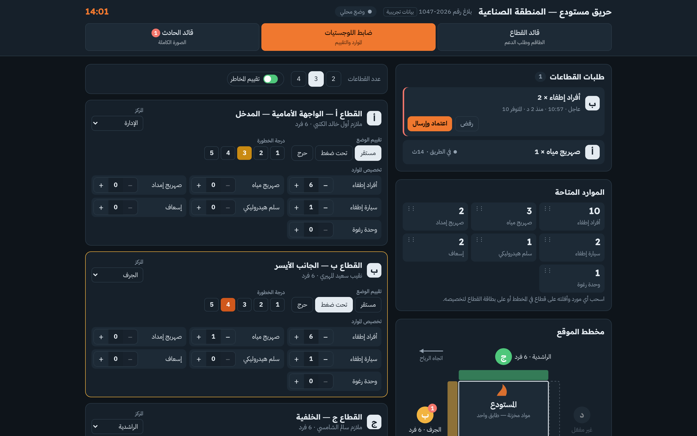

# منظومة قيادة الحادث — Incident Command App

تطبيق ويب عربي لإدارة الحادث بثلاث واجهات مترابطة: **قائد القطاع**، **ضابط اللوجستيات**، و**قائد الحادث**.

An Arabic (RTL) web app for running an incident with three linked views: Sector Commander, Logistics Officer and Incident Commander.

> النموذج يحتوي على بيانات تجريبية فقط (أسماء ومراكز للعرض).
> Prototype — all names and figures are sample data.

---

## الواجهات · Views

| الواجهة | ما تقدمه |
|---|---|
| **قائد القطاع** `#sc-A` … `#sc-D` | القطاع المكلّف به وحالته، طاقمه (اقتحام، إمداد مياه، خراطيم) ومواقعهم، شريط طلب دعم (أفراد، صهريج مياه، صهريج إمداد، سيارة إطفاء، سلم، إسعاف، رغوة) بأولوية عادي/عاجل، وإرسال صور وفيديو من الموقع إلى قائد الحادث |
| **ضابط اللوجستيات** `#lo` | الطلبات الواردة (العاجل أولًا) مع اعتماد/رفض، الموارد المتاحة، مخطط الموقع، عدد القطاعات (2–4)، تخصيص المراكز (مع خيار «أخرى» لإضافة مركز باسم المشرف ورقم هاتفه)، تخصيص الموارد بالسحب والإفلات، تقييم وضع كل قطاع ودرجة الخطورة 1–5 (قابلة للإيقاف) |
| **قائد الحادث** `#ic` | مؤشرات فورية، نمط العمليات (هجومي/دفاعي/انتقالي)، معرض الصور والفيديو من الميدان، كل طلبات الدعم وحالتها، بطاقات القطاعات مع الطاقم، وسجل أحداث زمني |

القطاع **أ** هو دائمًا الواجهة الأمامية والمدخل، وتُرقّم بقية القطاعات (ب، ج، د) باتجاه عقارب الساعة.





---

## التشغيل · Running it

لا يحتاج بناء ولا تثبيت: افتح `index.html` في أي متصفح حديث، أو شغّل خادمًا ثابتًا:

```bash
npx serve .        # أو
python3 -m http.server 8080
```

ثم افتح `http://localhost:8080/#lo` (أو `#sc-A` أو `#ic`).

العرض التقديمي موجود في `presentation/index.html` (المسافة أو ← للتقدم، F لملء الشاشة).

---

## مهم: الربط المباشر بين الأجهزة · Important: live sync

النسخة الحية من التطبيق تعمل داخل منصة Claude، وتعتمد على خدماتها للمزامنة بين الأجهزة ورفع الصور والفيديو (`window.claude`: `db` و `room` و `assets`).

**عند فتح هذا الملف خارج المنصة يعمل التطبيق في «وضع محلي»:** كل الواجهات تعمل على الجهاز نفسه، لكن لا توجد مزامنة بين الهواتف، والصور تبقى على الجهاز الذي التقطها.

للتشغيل الفعلي يلزم خادم خلفي (خادم داخلي، أو Firebase، أو Supabase …). طبقة الحفظ معزولة في دوال قليلة داخل `index.html` يمكن استبدالها:

| الدالة | وظيفتها |
|---|---|
| `connect()` | الاشتراك في التحديثات الحية |
| `patchInc(patch)` | تحديث حالة الحادث (دمج جزئي) |
| `putReq(request)` | إنشاء/تحديث طلب دعم |
| `addLog(text)` | إضافة سطر في سجل الأحداث |
| `sendMedia(file, kind)` | رفع صورة/فيديو وتسجيلها |
| `arrive(request)` | وصول الدعم (يمنع الاحتساب مرتين) |

### نموذج البيانات · Data model

- `incident/state` — مستند واحد: `start, n (2–4), riskOn, mode, pool{…}, customStations[{name, sup, phone}], sectors{A..D:{station, cmdr, status, risk, res{…}, crew[{name, role, pos}]}}`
- `requests/{id}` — `sec, type, qty, pri (normal|urgent), status (new|route|done|rej), t, eta`
- `log/{id}` — `t, text`
- `media/{id}` — `sec, kind (photo|video), asset, note, t`

---

## ملاحظات · Notes

- مصطلحات تقسيم القطاعات (أ في المقدمة ثم باتجاه عقارب الساعة) مأخوذة من الممارسة الشائعة في نظام قيادة الحادث، ولم تُطابَق بعد مع نص NFPA 1550 (الذي دمج NFPA 1561). يُنصح بمراجعتها مع إجراءات الإدارة المعتمدة.
- حجم الفيديو حتى 20 ميجابايت؛ تُصغَّر الصور تلقائيًا قبل الإرسال.
- الواجهة عربية بالكامل وتدعم الوضع الداكن والفاتح.
