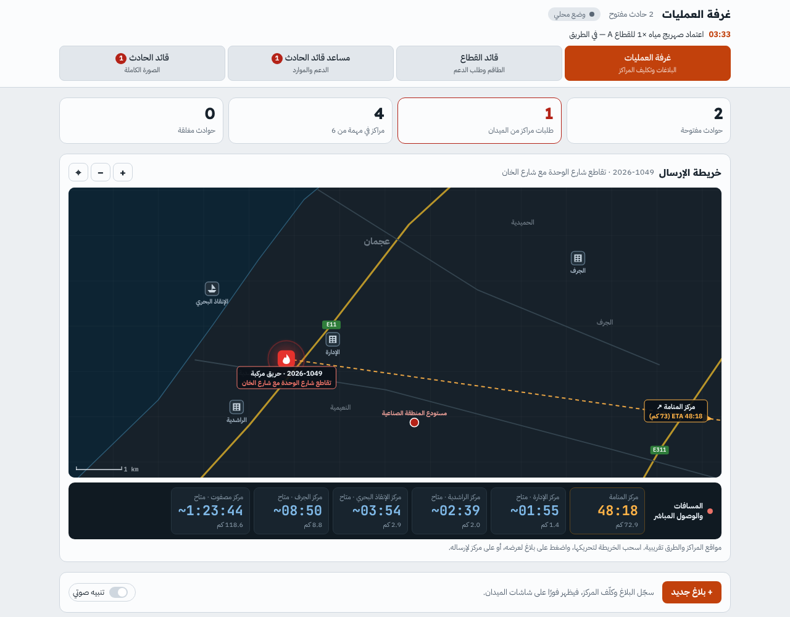
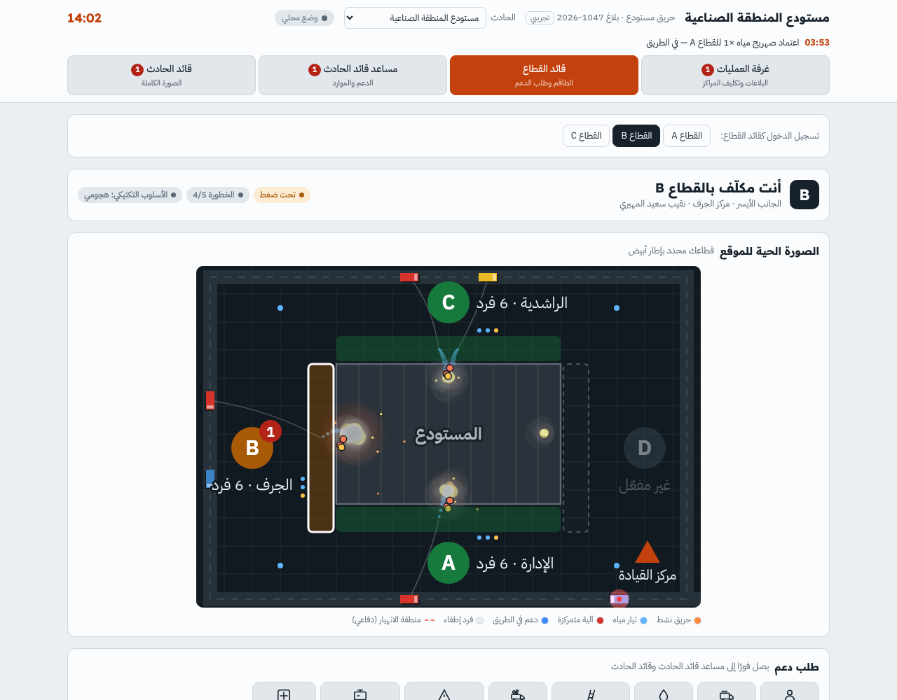
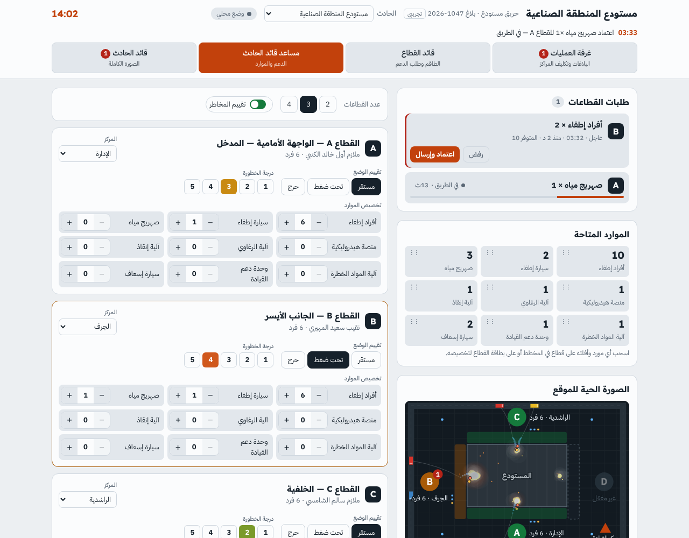
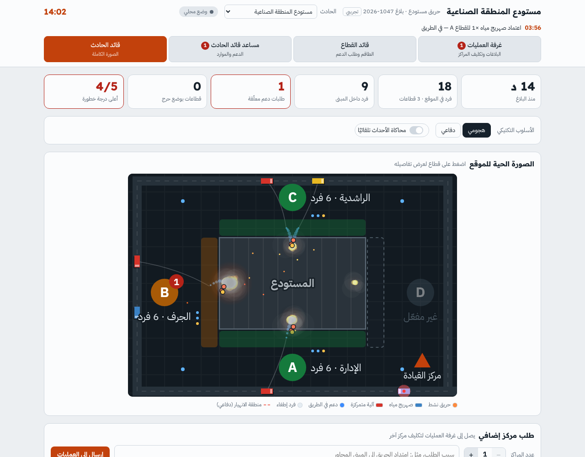

# منظومة قيادة الحادث — Incident Command App

تطبيق ويب عربي لإدارة الحوادث بأربع واجهات مترابطة: **غرفة العمليات**، **قائد القطاع**، **مساعد قائد الحادث**، و**قائد الحادث**. المصطلحات ومسميات الآليات مأخوذة من دليل إجراءات الطوارئ (SOP).

An Arabic (RTL) web app for running incidents with four linked views: Operations Room, Sector Commander, Assistant Incident Commander and Incident Commander. Terminology and vehicle names follow the department SOP.

> النموذج يحتوي على بيانات تجريبية فقط (أسماء ومراكز ومواقع للعرض).
> Prototype — all names, stations, locations and figures are sample data.

---

## الواجهات · Views

| الواجهة | ما تقدمه |
|---|---|
| **غرفة العمليات** `#op` | تسجيل بلاغ جديد (الموقع، الإحداثيات، أقرب معلم، نوع الحادث، معلومات حرجة)، تكليف المراكز، خريطة الإرسال مع المسافات وزمن الوصول، مراحل الاستجابة وأولوية كل حادث، لوحة المراكز، ومعالجة طلبات المراكز الإضافية من الميدان |
| **قائد القطاع** `#sc-A` … `#sc-D` | القطاع المكلّف به وحالته، الصورة الحية للموقع، طاقمه ومواقعهم، طلب دعم بأولوية عادي/عاجل، بلاغ صوتي يتحول إلى طلبات، وإرسال صور وفيديو من الموقع |
| **مساعد قائد الحادث** `#lo` | الطلبات الواردة (العاجل أولًا) مع اعتماد/رفض، الموارد المتاحة، عدد القطاعات (2–4)، تخصيص المراكز، تخصيص الموارد بالسحب والإفلات، تقييم وضع كل قطاع ودرجة الخطورة 1–5 |
| **قائد الحادث** `#ic` | مؤشرات فورية، الأسلوب التكتيكي (هجومي/دفاعي) مع تحذير وأمر إخلاء، الصورة الحية للموقع، طلب مركز إضافي من غرفة العمليات، الصور والفيديو مع التحليل الذكي، حالة القطاعات وسجل الأحداث |

- القطاع **A** هو المدخل الرئيسي أو نقطة المكافحة الأولى، وتُرقّم بقية القطاعات (B، C، D) باتجاه عقارب الساعة.
- يمكن متابعة أكثر من حادث في الوقت نفسه، واختيار الحادث من أعلى الشاشة.

### الآليات وطلبات الدعم · Resources

أفراد إطفاء، سيارة إطفاء، صهريج مياه، منصة هيدروليكية، آلية الرغاوي، آلية المواد الخطرة، وحدة دعم القيادة، سيارة إسعاف.

### الذكاء الاصطناعي · AI features

- **تحليل صور الميدان:** يقرأ الصورة ويقترح ملخصًا والمخاطر الظاهرة وإجراءات مقترحة لقائد الحادث.
- **رسالة صوتية مع الصورة:** بعد التصوير يتكلم قائد القطاع فيتحول كلامه إلى نص (التعرف على الكلام في المتصفح، باللهجة الإماراتية)، ويُرسل مع الصورة إلى قائد الحادث.
- **توصية حسب دليل الإجراءات:** يراجع الذكاء الاصطناعي الصورة والرسالة ومعلومات الحادث مقابل المقاطع المناسبة من دليل إجراءات الطوارئ (26 مقطعًا مختصرًا داخل التطبيق)، ويقترح الأسلوب التكتيكي وإجراءات مرقمة مع مرجع كل إجراء (رقم الإجراء والصفحة). القرار لقائد الحادث.
- **البلاغ الصوتي:** يتكلم قائد القطاع باللهجة، فيتحول الكلام إلى طلبات دعم وتقييم للقطاع وسطر في السجل، ويعتمدها قائد القطاع قبل الإرسال.






---

## الملفات · Files

| الملف | المحتوى |
|---|---|
| `index.html` | التطبيق كاملًا في ملف واحد |
| `devices.html` | اختيار الجهاز: رابط لكل واجهة |
| `firebase-config.js` | إعدادات مشروع Firebase (فارغ = وضع محلي) |
| `backend-firebase.js` | ربط التطبيق بـ Firebase: المزامنة، الصور، الأجهزة المتصلة، العمل دون اتصال |
| `firestore.rules` / `storage.rules` / `firebase.json` | قواعد الحماية وإعداد المحاكي المحلي |
| `vendor/firebase/` | مكتبات Firebase محفوظة داخل المستودع (لا تعتمد على مصدر خارجي) |
| `docs/FIREBASE_SETUP.md` | خطوات إنشاء مشروع Firebase وربط الأجهزة |
| `presentation/index.html` | العرض التقديمي التفاعلي (المسافة أو ← للتقدم، F لملء الشاشة) |
| `docs/development-plan.pdf` | خطة التطوير والجدول الزمني |
| `docs/screenshots/` | لقطات الشاشات |

---

## التشغيل · Running it

لا يحتاج بناء ولا تثبيت: افتح `index.html` في أي متصفح حديث، أو شغّل خادمًا ثابتًا:

```bash
npx serve .        # أو
python3 -m http.server 8080
```

ثم افتح `http://localhost:8080/devices.html` واختر الجهاز.

## واجهة لكل جهاز · One interface per device

كل رابط يفتح واجهة دور واحد بتصميم يناسب جهازه، دون أزرار التنقل بين الأدوار:

| الجهاز | الرابط | التصميم |
|---|---|---|
| حاسوب غرفة العمليات | `index.html?d=ops` | شاشة عريضة: الحوادث المفتوحة بجانب خريطة إرسال كبيرة، والمراكز تحتها |
| آيباد قائد الحادث | `index.html?d=ic` | عمودان: المؤشرات والصورة الحية والقطاعات، وبجانبها الطلبات والصور والسجل |
| آيباد مساعد قائد الحادث | `index.html?d=aic` | الطلبات والموارد ثابتة على جانب، وبطاقات القطاعات على الجانب الآخر، وأزرار أكبر للمس |
| هاتف قائد القطاع | `index.html?d=sector` | عمود واحد وشريط سفلي بثلاثة أزرار: طلب دعم، صورة، بلاغ صوتي |

`index.html` بدون `?d=` هو وضع العرض بكل الواجهات على جهاز واحد.

---

## الربط المباشر بين الأجهزة · Live sync

النسخة على GitHub تتصل بمشروع **Firebase** خاص بكم: المزامنة اللحظية بين الأجهزة (Firestore)، والصور والفيديو (Storage)، ومعرفة الأجهزة المتصلة، والعمل دون اتصال ثم الإرسال عند عودته. خطوات الإعداد في [`docs/FIREBASE_SETUP.md`](docs/FIREBASE_SETUP.md).

- **قبل الإعداد** (`firebase-config.js` فارغ): يعمل التطبيق في «وضع محلي» على كل جهاز وحده.
- **الذكاء الاصطناعي** (تحليل الصور وتحويل البلاغ الصوتي) يعمل حاليًا في نسخة claude.ai فقط، ولم يُربط بعد في نسخة Firebase.
- **للتجربة ببيانات وهمية فقط.** التشغيل الفعلي يكون على خوادم الشبكة الداخلية (انظر خطة التطوير).

طبقة الحفظ معزولة في دوال قليلة داخل `index.html`، ويمكن نقلها لاحقًا إلى خادم داخلي:

| الدالة | وظيفتها |
|---|---|
| `connect()` | الاشتراك في التحديثات الحية |
| `selectInc(id)` | متابعة حادث محدد (طلباته وسجله وصوره) |
| `patchInc(patch, id)` | تحديث حالة الحادث (دمج جزئي) |
| `putReq(request)` | إنشاء/تحديث طلب دعم |
| `putOps(request)` | طلب مركز إضافي لغرفة العمليات |
| `addLog(text, id)` | إضافة سطر في سجل الأحداث |
| `sendMedia(file, kind)` | رفع صورة/فيديو وتسجيلها |
| `arrive(request)` | وصول الدعم (يمنع الاحتساب مرتين) |
| `analyzeMedia(m)` / `parseVoice(text)` | التحليل الذكي للصور والبلاغ الصوتي |

### نموذج البيانات · Data model

- `incidents/{id}` — الحادث: النوع، الاسم، الموقع والإحداثيات، المراكز المكلّفة، المرحلة والأولوية، `n (2–4), riskOn, mode (off|def), pool{…}, sectors{A..D:{station, cmdr, status, risk, res{…}, crew[…]}}`
- `incidents/{id}/requests/{id}` — `sec, type, qty, pri (normal|urgent), status (new|route|done|rej), t, eta`
- `incidents/{id}/log/{id}` — `t, text`
- `incidents/{id}/media/{id}` — `sec, kind (photo|video), asset, note, t, ai`
- `opsreq/{id}` — طلبات المراكز الإضافية التي تعالجها غرفة العمليات

---

## ملاحظات · Notes

- مواقع المراكز والطرق على خريطة الإرسال تقريبية للعرض فقط.
- حجم الفيديو حتى 20 ميجابايت؛ تُصغَّر الصور تلقائيًا قبل الإرسال.
- الواجهة عربية بالكامل وتدعم الوضع الداكن والفاتح.
